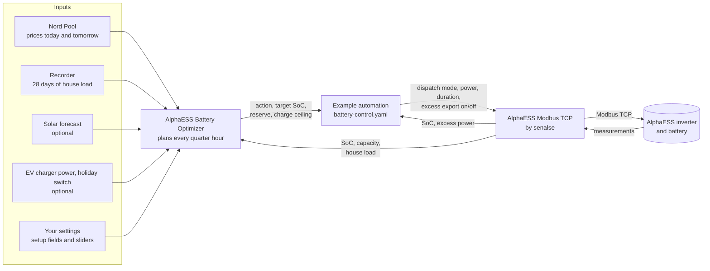
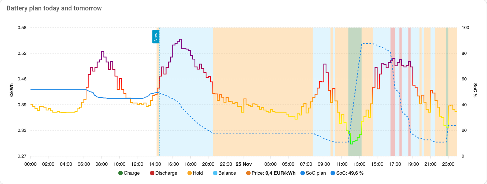

# AlphaESS Battery Optimizer for Home Assistant

A Home Assistant integration that plans when an AlphaESS home battery should charge,
discharge or wait, based on dynamic electricity prices.

I built it to run several strategies at once on my own AlphaESS battery. It reads the
battery through the [AlphaESS Modbus TCP integration](https://github.com/senalse/ha-alphaess-modbus)
by senalse, which does the hard work of talking to the inverter. Many thanks for that.

Your own home comes first: buy electricity when it's cheap, store solar energy, and use
what's stored in the house. Where it pays off, the optimizer sells the surplus to the grid.
You decide how far it goes with settings for aggressiveness, backup power and more.

Feedback is always welcome: open an [issue](https://github.com/jurrehaak86/alphaess-optimizer/issues).

## What it does

For every quarter hour the integration picks one of four actions: **charge**, **discharge**,
**balance** (the battery supplies the house) or **hold**. It plans across all known Nord Pool
prices (today, and tomorrow once they're published) with dynamic programming over the
state of charge, and replans every 15 minutes.

> **The integration advises; it does not control the inverter by itself.** It publishes the
> decision and the full plan as sensors. To act on it, add the example automation in
> [automations/battery-control.yaml](automations/battery-control.yaml); see
> [docs/automation.md](docs/automation.md). Not affiliated with AlphaESS.

### Best with a dynamic tariff

The optimizer earns its money from price differences between quarter hours: it charges when
power is cheap and uses or sells it when power is expensive. That needs a dynamic
(day-ahead) contract. On a fixed price there is little to plan, and the battery does about
the same as the self-consumption mode in the AlphaESS app.

### Countries and netting rules

Netting rules and energy tax are Dutch: netting (*saldering*) applies until the end of 2026
and ends in 2027. In 2027 the integration gets an update for the new Dutch rules.

Live somewhere else? Send me your country's rules (how export is paid, taxes, fees) in an
[issue](https://github.com/jurrehaak86/alphaess-optimizer/issues). I can build them in
with a country selector.

## How the pieces fit together

Three parts work in a chain: the optimizer plans, the automation decides what the inverter
does right now, and AlphaESS Modbus TCP sends that to the inverter.



| Part | Reads | Produces |
|---|---|---|
| **Optimizer** (this integration) | Nord Pool prices, state of charge and capacity, house load history from the recorder, solar forecast and EV charger power if you set them, the holiday switch, your settings (power, SoC limits, fees, aggressiveness, backup, energy tax, wear cost, netting regime) | `sensor.…_action` with the target SoC for the quarter, `sensor.…_reserve`, `sensor.…_charge_ceiling` and the full plan |
| **Automation** ([battery-control.yaml](automations/battery-control.yaml)) | The optimizer's sensors, the live state of charge, *Excess Power*, the clock (every quarter hour) | Dispatch mode, power and duration, and *Excess Export* on or off |
| **AlphaESS Modbus TCP** ([senalse](https://github.com/senalse/ha-alphaess-modbus)) | The dispatch entities the automation sets | Modbus writes to the inverter, and the measurements the other two parts read |

The optimizer never writes to the inverter. Turn the automation off and the inverter goes
back to its own settings once the last dispatch command runs out.



## Example: one year on the author's setup

What does it save? A backtest over one year of Dutch day-ahead prices (October 2025 to
October 2026), with the author's own consumption and solar production, compares three
situations:

- **No battery.**
- **AlphaESS app, self-consumption:** solar surplus goes into the battery, the house uses it
  when the sun is gone, never charging from the grid.
- **Optimizer:** this integration's planner, replanning every quarter hour with only the
  prices known at that moment, carried out the way the example automation does it.

Setup: 4,300 kWh household consumption per year (the electric car is left out, because it
charges straight from the grid at cheap hours), 3,140 kWh solar, an 18.6 kWh battery with
10 kW, aggressiveness 5.

| Energy cost per year, incl. VAT | No battery | AlphaESS app | Optimizer |
|---|---|---|---|
| 2026 rules (with netting) | €502 | €395 | €118 |
| Saving compared to no battery | | €107 | €384 |
| 2027 rules (no netting) | €705 | €462 | €361 |
| Saving compared to no battery | | €243 | €344 |
| Battery cycles per year (2026 / 2027) | | 51 / 51 | 128 / 91 |

So on top of the app the optimizer saved €277 a year under the 2026 rules and €101 under
the 2027 rules. It does cycle the battery more. At 3 cents of wear per discharged kWh, that
extra use costs about €41 (2026) and €21 (2027), which leaves €236 and €80.

How the numbers were made:

- Prices: Dutch day-ahead per quarter hour, with €0.018/kWh supplier fee each way, energy
  tax €0.0916/kWh and 21% VAT. Under the 2026 rules, export is netted against import with a
  €0.0248/kWh deduction.
- Consumption: a standard daily profile scaled to the real monthly totals. Solar: the real
  production per day, spread over the day by the position of the sun. Clouds within a day
  and peaks in consumption (cooking, heat pump) are not in it.
- Battery: 95% efficiency each way, usable between 4.4% and 98%. The charge ceiling comes
  from a solar forecast equal to yesterday's production.
- Fixed costs (standing charge, grid fees, tax credit) are the same in all three situations
  and left out.

Your result depends on your consumption, solar, battery size and how much prices move. With
a smaller battery or a fixed tariff the gain is smaller. Past prices don't guarantee future
ones.

## Requirements

| | |
|---|---|
| [AlphaESS Modbus TCP](https://github.com/senalse/ha-alphaess-modbus) | Required. State of charge, capacity and house load come from here. Should work with every model that integration supports; tested on a SMILE-G3-T10. The example automation needs v1.16.0 or newer |
| [Nord Pool, community version](https://github.com/custom-components/nordpool) | Required. Needs the `raw_today` / `raw_tomorrow` attributes. The built-in Nord Pool integration is not supported |
| Recorder | Built in. The consumption profile comes from long-term statistics |
| Solar forecast | Optional. Any sensor with "remaining today" in kWh (Forecast.Solar, Solcast, ...) |

## Installation

The full guide, with every setup field explained, is in [docs/installation.md](docs/installation.md).

1. Home Assistant 2026.11 and later: Settings → Marketplace → Add from link, and paste this repository's URL.
   On 2026.10 and older: HACS → ⋮ → Custom repositories → add it as *Integration*.
2. Install **AlphaESS Battery Optimizer** and restart Home Assistant.
3. Settings → Devices & services → Add integration → **AlphaESS Battery Optimizer**.

## Setup

Setup has four screens: battery, prices, solar and consumption. Each field has a short
help text in Home Assistant. [docs/installation.md](docs/installation.md) explains every
field in full: what it means, where to find the value and what to fill in.

Everything except the inverter can be changed later under *Configure*.

## Entities

| Entity | |
|---|---|
| `sensor.…_action` | `charge` / `discharge` / `balance` / `hold`. Attributes: reason, plan in blocks, `plan_quarters` (start, action, SoC, price), reserve, cycles, cost |
| `sensor.…_next_charge` / `_next_discharge` / `_next_hold` | Next block as text, e.g. `tomorrow 06:00–06:30 · 55%` |
| `sensor.…_reserve`, `sensor.…_charge_ceiling` | Diagnostics |
| `number.…_aggressiveness` | 1 = only own consumption, 5 = default, 10 = free trading |
| `number.…_backup_target`, `…_backup_weight` | Soft lower bound for backup |
| `number.…_energy_tax`, `…_wear_cost` | EUR/kWh. Update the energy tax every 1 January |
| `select.…_netting_regime` | `2026` (netting) or `2027` (no netting) |

## How it decides

- **Own consumption first** (levels 1–7): first a plan without selling, then selling only
  what is above the reserve (consumption until the next charging moment). Never buys to
  sell, never holds at the expense of own use.
- **Optimal** (levels 8–10): free optimisation.
- Remaining charge at the end of the horizon is valued at ETA × a price quantile, so the
  battery is not drained at the horizon edge.
- A daily cycle limit is enforced with a Lagrange penalty on discharged kWh.
- Wear cost per discharged kWh is part of every trade-off.

## Known limitations

- The plan doesn't count on solar production per quarter hour. The solar forecast only
  lowers the charge ceiling, so on a sunny day the real state of charge can rise faster
  than planned. The optimizer replans every quarter hour and catches up.
- Days on which the holiday switch was on still count in the consumption profile. For
  four weeks after a holiday the profile, and so the reserve, comes out somewhat low.
- Prices only come from the community Nord Pool integration. The built-in Nord Pool
  integration and other price sources (Tibber, ENTSO-e and so on) aren't supported.

## Controlling the battery

[automations/battery-control.yaml](automations/battery-control.yaml) carries out the advice
through the dispatch entities of AlphaESS Modbus TCP: the automation that controls the
author's own battery. [docs/automation.md](docs/automation.md) explains what it does and what
to check before you add it.

## Dashboard

An example view with the plan chart, live values and the optimizer settings is in
[dashboard/battery-view.yaml](dashboard/battery-view.yaml). See [docs/dashboard.md](docs/dashboard.md).

## Development

`tests/test_kern_gelijk.py` checks that the planning core is identical to the pyscript
version that runs the author's own battery. That reference file isn't in this repository,
so the check only runs where it is available:

```bash
python3 tests/test_kern_gelijk.py path/to/accu_optimizer.py
```

The Home Assistant tests use `pytest-homeassistant`, which Home Assistant publishes with
every release and which pins that same version. It needs Python 3.14 or newer. Bump the
pin in `requirements_test.txt` together with the Home Assistant you run.

```bash
uv venv --python 3.14 .venv
uv pip install --python .venv/bin/python -r requirements_test.txt
.venv/bin/python -m pytest
```

## About this project

I developed this with Claude, which also wrote the scripts. The battery control has been
tested for several months on my own setup and works as intended. The planning core in this
integration is the same code that plans my battery today; packaging it as an integration
(v0.1) is new.

Feedback is always welcome: open an [issue](https://github.com/jurrehaak86/alphaess-optimizer/issues).
