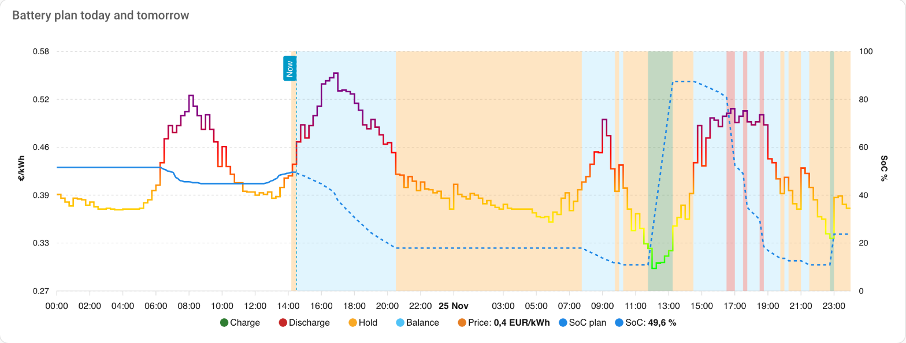

# Example dashboard

[`dashboard/battery-view.yaml`](../dashboard/battery-view.yaml) is a complete dashboard
view in the sections layout. It has three sections:

- Battery plan: a chart with the price per quarter hour, the planned action as coloured
  bands, and the planned and actual state of charge.
- Live: inverter power, SoC, PV, grid, house load, dispatch mode, and the reserve and
  charge ceiling the optimizer uses.
- Optimizer: the current action with its reason, the next charge, discharge and hold
  moments, sliders for aggressiveness and backup, and a 24-hour history.



*The example view a few minutes after setup. Left of "Now" the bands come from the history of
the Action sensor, so they fill in over the first day.*

## What you need

- [apexcharts-card](https://github.com/RomRider/apexcharts-card), installed from the
  Marketplace (or HACS on Home Assistant 2026.10 and older). Only the plan chart uses it; the other cards are built in.
- The integration set up as described in [installation.md](installation.md).

## Add the view

1. Open the dashboard you want to add it to and click the pencil (edit).
2. Click **+** next to the existing views to add a view.
3. In the view dialog, open the menu (⋮) and choose **Edit in YAML**.
4. Replace everything with the contents of `battery-view.yaml` and save.

You can also paste it into the raw configuration editor, as one more item under `views:`.

## Entity IDs

The YAML uses the IDs you get with default names:

| In the YAML | Comes from |
|---|---|
| `sensor.optimizer_alphaess_inverter_…`, `number.optimizer_alphaess_inverter_…` | This integration, with an inverter device called *AlphaESS Inverter* |
| `sensor.alphaess_inverter_…`, `select.alphaess_inverter_dispatch_mode` | AlphaESS Modbus TCP |
| `sensor.nordpool_kwh_nl_eur_3_10_0` | Nord Pool (community version). Yours almost certainly has a different name |

Look up your own IDs under **Settings → Devices & services → Entities** and use find and
replace in the YAML before you save. The Nord Pool ID appears in the chart and in the two
conditions that switch between the one-day and two-day chart.

## Reading the chart

| Colour | Meaning |
|---|---|
| Green band | charge |
| Red band | discharge |
| Orange band | hold |
| Light blue band | balance |
| Coloured step line | price per quarter hour, from pink (cheap) through green and yellow to purple (expensive) |
| Dashed blue line | planned SoC at the end of each quarter |
| Solid blue line | actual SoC |

Bands to the right of "Now" are the plan. Bands to the left are what the optimizer
advised earlier, taken from the history of the Action sensor. Since v0.1 only advises,
they show the advice, not what the inverter did.

Before tomorrow's prices are published (around 13:00) the chart covers today only.
After that it switches to today and tomorrow. Both versions are in the YAML; a
conditional card shows the right one.

The colour scale of the price line uses fixed values in €/kWh, set for Dutch all-in
prices. If your prices are much lower or higher, change the `color_threshold` values.

## Changing the view

The YAML is generated by [`dashboard/build_view.py`](../dashboard/build_view.py) so the
one-day and two-day charts stay identical. If you want to adapt it for your own entity
IDs once and keep it, change the constants at the top of that script and run:

```bash
pip install pyyaml
python3 dashboard/build_view.py
```
